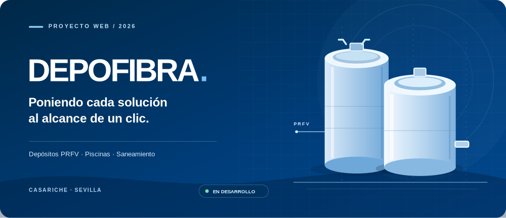
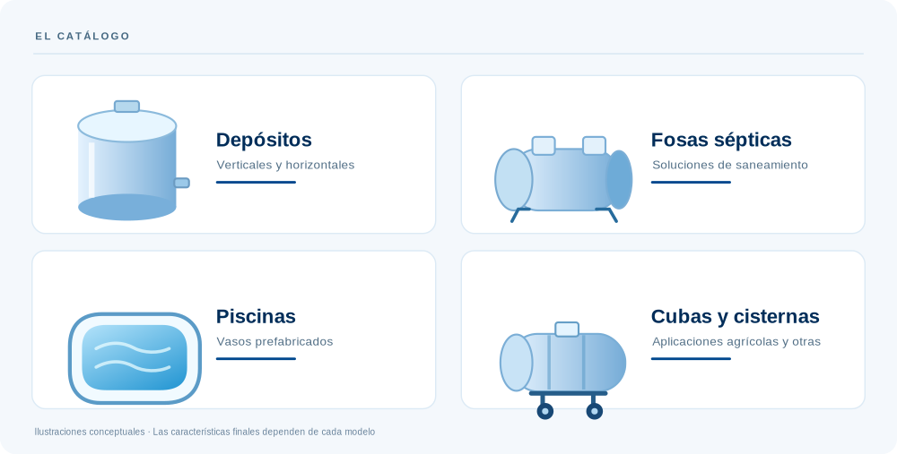

<p align="center">
  
</p>

<p align="center">
  <a href="https://depofibra.com/"><b>Web actual</b></a>
  &nbsp;·&nbsp;
  <a href="https://demo.depofibra.com/"><b>Vista del proyecto</b></a>
  &nbsp;·&nbsp;
  <a href="https://www.instagram.com/depofibra/"><b>Instagram</b></a>
</p>

<p align="center">
  
  
  
</p>

<br />

<h2 align="center">Un catálogo que pone las cosas fáciles.</h2>

<p align="center">
  Una nueva web para <strong>Depofibra</strong>, negocio de Casariche (Sevilla) especializado en la
  <strong>comercialización de soluciones de poliéster reforzado con fibra de vidrio (PRFV)</strong>.
  Diseñada para descubrir productos, entender sus características y solicitar información con claridad.
</p>

<br />

## El catálogo, en primer plano

<p>
  
</p>

No queremos una web llena de información dispersa. Queremos que cada visitante encuentre el tipo de producto que busca y avance hacia una ficha útil, con información técnica verificable y una forma sencilla de solicitar presupuesto.

## Pensada para el usuario. Construida para crecer.

<table>
  <tr>
    <td width="33%" valign="top">
      <h3>01 / Claridad</h3>
      <p>Categorías reconocibles, navegación directa y contenidos fáciles de entender.</p>
    </td>
    <td width="33%" valign="top">
      <h3>02 / Confianza</h3>
      <p>Fotografías reales, características contrastadas y comunicación comercial transparente.</p>
    </td>
    <td width="34%" valign="top">
      <h3>03 / Rendimiento</h3>
      <p>Una base ligera y adaptable para una experiencia cómoda en móvil y ordenador.</p>
    </td>
  </tr>
</table>

### La experiencia que queremos construir

<p>
  
</p>

## Por dentro

Este proyecto utiliza **Astro 7**, componentes `.astro`, estilos CSS y una arquitectura orientada a crecer desde la página de inicio hacia categorías y fichas individuales.

| Base del proyecto | Enfoque |
| :-- | :-- |
| **Astro 7** | Estructura web ligera y basada en componentes |
| **Plus Jakarta Sans + Inter** | Sistema tipográfico coherente |
| **Azul `#01488e`** | Identidad visual de Depofibra |
| **Diseño responsive** | Prioridad a la navegación móvil |
| **SEO técnico** | Metadatos y estructura semántica con revisión continua |

<details>
<summary><strong>Desarrollo local · Ver comandos y estructura</strong></summary>

<br />

Requiere **Node.js 22.23.4 o superior**.

```bash
npm ci
npm run dev
```

Después, abre `http://localhost:4321`.

| Comando | Uso |
| :-- | :-- |
| `npm run dev` | Servidor de desarrollo |
| `npm run build` | Generar la versión de producción |
| `npm run preview` | Vista previa local de la compilación |

```text
src/
├── components/   # Cabecera, pie, navegación, modal…
├── layouts/      # Diseño compartido
├── pages/        # Páginas del sitio
└── styles/       # Estilos globales

public/           # Recursos estáticos
```

</details>

## En evolución

**Esta es la nueva web de Depofibra, todavía en desarrollo.** La versión de demostración no debe interpretarse como catálogo definitivo ni como un sistema de presupuestos ya operativo.

- [x] Base inicial de la página de inicio, navegación y sistema visual.
- [ ] Completar las categorías y fichas de producto.
- [ ] Verificar especificaciones, fotografías y documentación con los proveedores.
- [ ] Conectar y probar el envío real de solicitudes.
- [ ] Revisar accesibilidad, rendimiento, SEO y pruebas responsive.
- [ ] Preparar el lanzamiento y las redirecciones necesarias desde la web anterior.

<br />

---

<p align="center">
  <strong>DEPOFIBRA</strong><br />
  <sub>Casariche · Sevilla · España</sub><br /><br />
  <a href="https://depofibra.com/">depofibra.com</a>
  &nbsp;·&nbsp;
  <a href="https://demo.depofibra.com/">Ver nueva web</a>
</p>
